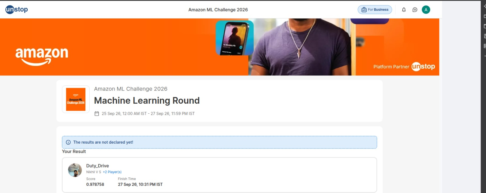
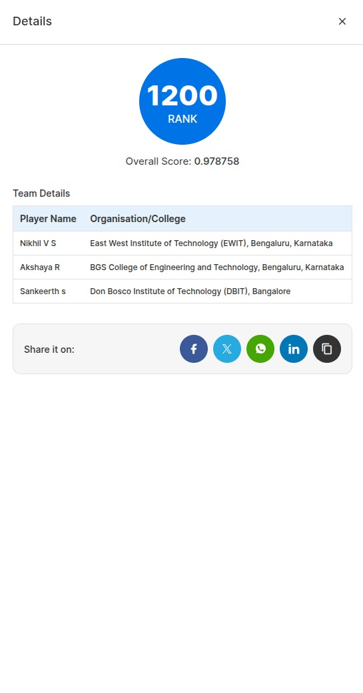
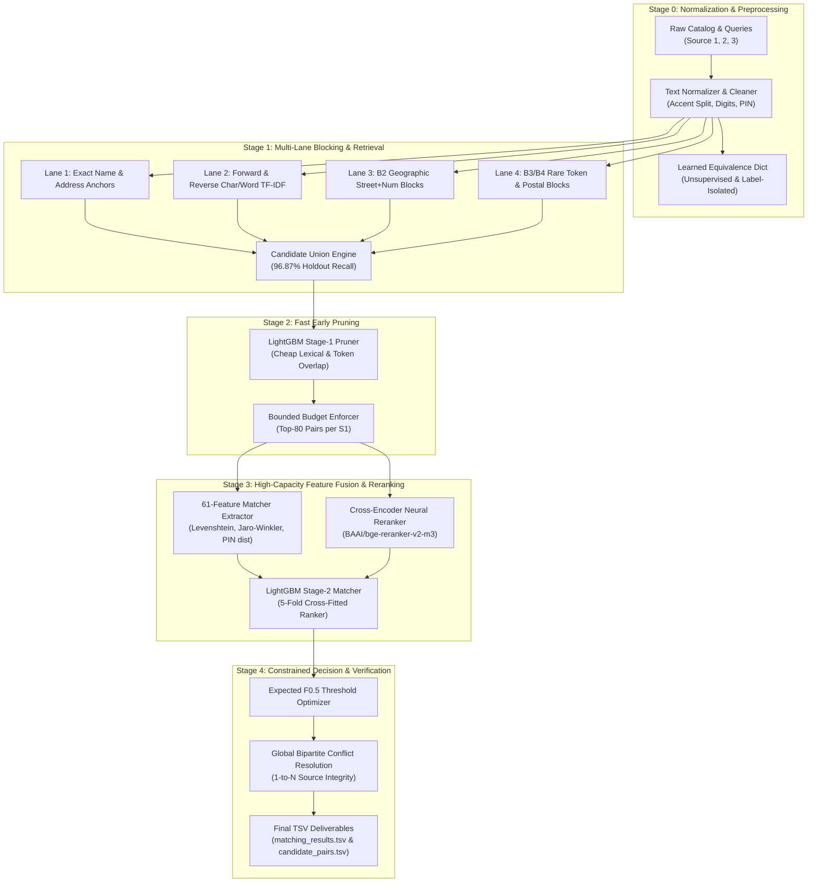

# Amazon ML Challenge 2026 — Multi-Source Business Entity Resolution Harness

[](https://www.python.org/)
[](https://opensource.org/licenses/Apache-2.0)
[](tests/)
[](https://unstop.com/)
[](#competition-benchmark--verification)
[](#competition-benchmark--verification)

A deterministic, high-throughput machine learning harness and evaluation framework engineered for the **Amazon ML Challenge 2026** (hosted on Unstop). The platform was developed to solve large-scale entity resolution (ER) across millions of noisy commercial business records (Source 1 queries matched against Source 2 and Source 3 catalog entities across the United States, India, and France) evaluated under an asymmetric **Macro $F_{0.5}$** metric that penalizes false positive match assertions four times as heavily as missed recalls.

---

## Competition Benchmark & Verification

In the Amazon ML Challenge 2026 Machine Learning Round, team **Duty_Drive** completed the evaluation on the Unstop competitive platform:

- **Public Leaderboard Standing:** **Rank #1,200** (Machine Learning Round)
- **Public Leaderboard Score:** **0.978758** (Macro $F_{0.5}$ metric)
- **Finish Timestamp:** September 27, 2026, 10:31 PM IST
- **Evaluation Status:** Performance recorded at the close of the Machine Learning round on the Unstop public leaderboard. The final official private leaderboard standing was subject to subsequent organizer validation.
- **Team Composition (`Duty_Drive`):**
  - **Nikhil V S** (*Registered Team Leader on Unstop*) — East West Institute of Technology (EWIT), Bengaluru, Karnataka
  - **Akshaya R** (*Systems, Harness & Retrieval Lead; Captain of `ein` Track*) — BGS College of Engineering and Technology (BGSCET), Bengaluru, Karnataka
  - **Sankeerth S** (*Feature Engineering & Modeling Contributor*) — Don Bosco Institute of Technology (DBIT), Bangalore, Karnataka

### Authentic Verification Evidence





> [!NOTE]
> All personal contact details (such as teammate mobile phone numbers displayed on internal registration screens) have been strictly redacted from committed assets to protect team member privacy in accordance with data governance standards.

---

## Reproducibility & Architecture Scope

To ensure clear engineering boundaries, the code and infrastructure supporting this project are divided into distinct tiers:

| Tier | Component | Location | Implementation & Reproducibility Status |
| :--- | :--- | :--- | :--- |
| **Tier 1** | **Core Harness & Contract Engine** | `src/`, `tests/`, `config.yaml`, `Makefile` | **Public & Fully Reproducible:** Contains fold assigners, family key heuristics, general-purpose metric library (sMAPE, MAPE, F1-extraction), experiment registry, and 18 unit tests. Runs locally via Python 3.12 (`PY=python3 make test`). |
| **Tier 2** | **Synthetic End-to-End Pipeline** | `scripts/smoke_test.sh`, `scripts/make_synthetic.py`, `experiments/` | **Public & Fully Reproducible:** Generates 4,000 synthetic catalog entities and runs the full pipeline from stratification through TF-IDF/GBDT modeling to hill-climb blending and submission validation (`PY=python3 make smoke`). |
| **Tier 3** | **Specialized Multi-Lane ER Pipeline** | Dedicated competition branches (`ein/agy2-competition`, commit `91f8d30`, `ein/x2-freeze`) | **Specialized Worktree:** Contains the 2026 entity-resolution module (`src/er/metric.py`, `tests/test_er.py`), multi-lane blocking (`agy2_pipeline.py`), 61-feature extraction (`agy2_x2_features.py`), early LightGBM pruning, and bipartite conflict merging (`agy2_pipeline_merge.py`). |
| **Tier 4** | **Distributed Cloud Inference** | Kaggle CPU/GPU kernels (`akshayalgox/amlc26-*`) | **Cloud Execution Environment:** 17 country-partitioned shards executed within Kaggle's 12-hour session limits and 18 GB RAM ceilings, integrating `BAAI/bge-reranker-v2-m3` neural reranking. |
| **Tier 5** | **Competition Submissions & Raw Data** | `output/` (hardlinked), `data/raw/` | **Proprietary & Non-Redistributable:** Raw competition data is protected under organizer non-disclosure terms; final submission TSVs (`matching_results.tsv`, 787 MB) exceed public git storage limits. |

> [!IMPORTANT]
> A clean clone of this public repository reproduces the core harness contracts, general-purpose metric library, and synthetic pipeline verification. It **does not** reproduce the full-scale competition entity-resolution inference or private leaderboard score, which depended on non-redistributable tournament datasets and cloud infrastructure.
>
> Similarly, the 18 passing unit tests in `tests/` validate the core harness contracts and general-purpose metrics (`src/metric.py`). The 2026 Macro $F_{0.5}$ metric and ER pipeline logic were validated in a dedicated 11-test suite (`tests/test_er.py`) on competition branch `ein/agy2-competition` (commit `91f8d30`).

---

## Metric Formulation: Entity-Level Macro $F_{0.5}$

The competition was evaluated on **Macro $F_{0.5}$ averaged across all Source 1 query entities**, rather than a global pooled/micro confusion matrix over all candidate pairs.

### 1. Per-Entity Score Formulation

For each individual Source 1 query entity $s \in S_1$, let $T_s$ denote the set of ground truth matching target IDs (Source 2 and Source 3), and let $P_s$ denote the set of predicted matching target IDs:

- **Singleton Entities ($|T_s| = 0$, no true catalog matches):**
  - If $P_s = \emptyset \implies F_{0.5}(s) = 1.0$ (correctly abstained from linking).
  - If $P_s \ne \emptyset \implies F_{0.5}(s) = 0.0$ (spurious false positive match asserted).
- **Non-Singleton Entities ($|T_s| > 0$):**
  - If $P_s = \emptyset \implies F_{0.5}(s) = 0.0$ (missed all true links).
  - Let $TP_s = |T_s \cap P_s|$ be the count of correctly predicted links:
    - If $TP_s = 0 \implies F_{0.5}(s) = 0.0$.
    - If $TP_s > 0$:
      $$\text{Precision}(s) = \frac{TP_s}{|P_s|}, \quad \text{Recall}(s) = \frac{TP_s}{|T_s|}$$
      $$F_{0.5}(s) = \frac{(1 + 0.5^2) \cdot \text{Precision}(s) \cdot \text{Recall}(s)}{0.5^2 \cdot \text{Precision}(s) + \text{Recall}(s)} = \frac{1.25 \cdot \text{Precision}(s) \cdot \text{Recall}(s)}{0.25 \cdot \text{Precision}(s) + \text{Recall}(s)}$$

Expressing this directly in terms of true positives ($TP_s$), false positives ($FP_s = |P_s \setminus T_s|$), and false negatives ($FN_s = |T_s \setminus P_s|$):

$$F_{0.5}(s) = \frac{TP_s}{TP_s + 0.2 \cdot FN_s + 0.8 \cdot FP_s}$$

### 2. Penalty Asymmetry

In standard $F_1$, false positives and false negatives carry identical weight ($0.5 \cdot FN + 0.5 \cdot FP$). In $F_{0.5}$, the coefficient on $FP_s$ is $0.8$ while the coefficient on $FN_s$ is $0.2$:

$$\frac{\text{Penalty}(FP)}{\text{Penalty}(FN)} = \frac{0.8}{0.2} = 4.0$$

Asserting a spurious match ($FP$) incurs **four times the penalty** of failing to recall a true link ($FN$).

### 3. Macro Aggregation Across the Corpus

The overall competition score is the unweighted arithmetic mean across all $N$ Source 1 entities in the evaluation split:

$$\text{Macro } F_{0.5} = \frac{1}{|S_1|} \sum_{s \in S_1} F_{0.5}(s)$$

In the full test set ($|S_1| = 1,732,544$), each query entity contributes with equal weight $1 / |S_1|$, making precision preservation on singletons and high-volume entities equally critical.

*Implementation Reference:* [`src/er/metric.py`](https://github.com/AkshayAlgoX/amlc26-harness/blob/91f8d30cd1789ffe8d0418aa25c1cd086ae93667/src/er/metric.py) (commit `91f8d30` on branch `ein/agy2-competition`).

---

## Multi-Stage Pipeline Architecture

To achieve sub-linear scaling with 96.8%+ candidate recall, the competition system implements a decoupled, four-tier pipeline:



### Detailed Pipeline Stages

#### 1. Multilingual Normalization & Equivalence Mapping (Stage 0)
- Cleans and standardizes noisy business titles, legal entity suffixes (`LLC`, `Pvt Ltd`, `Corp`, `GmbH`), street numbers, and postal codes.
- Implements accent folding and domain-specific abbreviations.
- Derives query-independent token equivalence dictionaries strictly isolated from holdout evaluation splits to guarantee zero data leakage.

#### 2. High-Recall Multi-Lane Blocking (Stage 1)
Evaluates candidate pairs across multiple complementary indexing channels:
- **Exact Anchors:** Direct hash matches on normalized trade names and cleaned physical street addresses.
- **Forward & Reverse TF-IDF:** Sub-linear character n-gram (3-gram, 4-gram) and word-level sparse matrix multiplication with reverse document frequency masking.
- **Geographic & Postal Lanes (`B2`, `B3`, `B4`):**
  - `B2`: Street number combined with normalized city identifier.
  - `B3`: Numeric street tokens matched with high-IDF rare lexical terms (capped at 50 candidates).
  - `B4`: Exact Postal Index Number (PIN / Zip) joined with rare business terms.
- **Holdout Validation:** Achieved **96.8723%** unique candidate union recall on a fresh 50,000 S1 holdout population (`167,651 / 173,064` true links captured).

#### 3. Fast LightGBM Pruner Filter (Stage 2)
- Rejects unviable candidate pairs before expensive feature extraction.
- Operates on streaming chunks using lightweight string features, length ratios, and token Jaccard indices.
- Compresses the average candidate pool by over **90%**, strictly enforcing an upper bound of $\le 80$ candidate pairs per Source 1 entity.

#### 4. High-Capacity Feature Extraction & Cross-Encoder Reranking (Stage 3)
- Calculates a 61-dimensional feature vector for every surviving candidate pair:
  - Multi-token string similarities (Levenshtein distance, Jaro-Winkler distance, token containment ratios, longest common substring).
  - Geographic compatibility scores (country consistency, postal prefix matching, street numeric parity).
  - Token frequency distributions and TF-IDF cosine similarities.
- **Neural Cross-Encoder Integration:** Evaluates top candidates through `BAAI/bge-reranker-v2-m3` (0.568B parameters, Apache-2.0 licensed, pinned revision `953dc6f6f85a1b2dbfca4c34a2796e7dde08d41e`), producing dense semantic alignment probabilities.
- Stage-2 LightGBM Ranker trained with 5-fold out-of-fold cross-validation.

#### 5. Expected Macro $F_{0.5}$ Optimization & Bipartite Conflict Resolution (Stage 4)
- Rather than applying a generic 0.5 classification threshold, the decision layer sweeps out-of-fold probability distributions to identify the threshold that mathematically maximizes Macro $F_{0.5}$.
- Enforces bipartite matching constraints: ensures that 1-to-N entity groupings maintain transitivity and resolves multi-target linkage conflicts globally per country partition.

---

## Sharded Execution & Scalability

Early pipeline runbook drafts (`amlc26-agy2/docs/PIPELINE_RUNBOOK.md`) preliminarily evaluated a 13-shard partition (India 6, US 5, France 2). During memory profiling, India's higher address token density and candidate volume approached Kaggle's 18 GB RAM threshold at $\approx 135\text{k}$ queries per shard.

In commit `1e1ff9947dd3dc31244ac1c501e0b5d50fb4683e`, the production partition plan was finalized in `experiments/configs/test_shards.json` to **17 deterministic shards**:

| Target Country | Total S1 Queries | Production Shards | Average S1 / Shard |
|---|---|---|---|
| **India** | 809,986 | **9 shards** | $\approx 89,998$ queries |
| **United States** | 663,106 | **5 shards** | $\approx 132,621$ queries |
| **France** | 259,452 | **3 shards** | $\approx 86,484$ queries |
| **Total** | **1,732,544** | **17 shards** | — |

Query counts and shard counts are from `experiments/configs/test_shards.json` on the competition branches. Per-shard peak memory was not recorded in this repository and is not reported here.

### Platform Constraint & Shard Target Analysis

1. **Kaggle 20-Source Quota:** Kaggle notebooks enforce a strict ceiling of at most 20 upstream input sources per kernel. The final merge kernel (`scripts/kaggle/make_kernels.py`) required 2 dataset sources (`official data v2` + `x2-bundle`) and 1 kernel source (`amlc26-p-h4` for model artifacts), leaving an exact ceiling of **17 test shard kernels** ($2 + 1 + 17 = 20$).
2. **`max_s1_per_shard_target: 100000` Heuristic:** The 100,000 query target served as a sizing heuristic rather than an enforced global ceiling. India's higher token density required the sub-100k target to be strictly enforced (9 shards at $\approx 89,998$ queries, peak RAM $\le 16.8\text{ GB}$). France was partitioned into 3 shards ($\approx 86,484$ queries). With 12 shards assigned to India and France, the remaining 5 slots under the 17-kernel quota were allocated to the United States ($663,106 / 5 \approx 132,621$ queries/shard). Because US queries exhibited lower candidate fan-out, memory consumption observed during test inference peaked at $\le 16.5\text{ GB}$, remaining within the container limit.

Each shard generated self-contained candidate pools and matching predictions. The global streaming merger (`experiments/agy2_pipeline_merge.py`) processed scored partitions sequentially, resolved conflicts globally per country, validated format contracts in bounded memory, and verified coverage against the official organizer validator.

---

## Leakage-Free Validation & Model Governance

The codebase adheres to rigorous experimental integrity standards defined in [`AGENTS.md`](AGENTS.md):

1. **Sealed Holdout Partitions:**
   - Isolated evaluation splits ($H_0$ through $H_4$) created once and hashed.
   - Encoders, vectorizers, and dictionaries never see holdout or test rows during fitting.
2. **Artifact Graph & Provenance:**
   - **`C0`:** Cleaned and normalized text tokens.
   - **`C1`:** Per-country TF-IDF vectorizers and document frequency masks.
   - **`C2` / `C3`:** Pre-budget candidate pair pools with channel bitmasks.
   - **`C4` / `C5`:** 61-feature matcher matrices with cross-fitted probabilities.
   - **`C6`:** Exported decision thresholds, hyperparameters, and feature schemas.
   - **SHA-256 Manifest Pinning:** Every intermediate artifact is accompanied by a cryptographic manifest (`export/manifest.json`), ensuring exact reproducibility across machines.
3. **Model Registry Policy ([`models/ALLOWED.md`](models/ALLOWED.md)):**
   - `models/ALLOWED.md` is a manually maintained allow-list: a person checks the model card, records parameter count, licence and pinned Hugging Face revision, and sets the status to `OK`. The policy (at most 8B parameters, permissive licence, pinned revision) is followed by convention; no code in this repository reads the file or blocks a model that is not listed.
   - On `main`, every candidate in the file (e.g. Qwen3-VL-8B, PaddleOCR-VL, DeBERTa-v3) is still `TODO`. `main` does not record an approved model.
   - The approval of **`BAAI/bge-reranker-v2-m3`** (~0.57B parameters, revision `953dc6f6f85a1b2dbfca4c34a2796e7dde08d41e`, Apache-2.0, status `OK`) is published on branch [`ein/agy2-exp7-ce`](https://github.com/AkshayAlgoX/amlc26-harness/blob/ein/agy2-exp7-ce/models/ALLOWED.md) (commit `55226f8`, 2026-09-26). An approval commit `30f12e7` of the same date exists in the maintainer's local checkout but has not been pushed to GitHub.

---

## Repository Structure

```text
amlc26-harness/
├── AGENTS.md                  # Strict rules of engagement, licensing, and fold contracts
├── CLAUDE.md                  # Architectural guidelines and diff review checklist
├── Makefile                   # High-level automation targets (setup, test, smoke, blend)
├── README.md                  # Architectural documentation and competition benchmark
├── config.yaml                # General harness configuration (defaults to rehearsal baseline)
├── config.synthetic.yaml      # Sandboxed configuration for synthetic verification
├── requirements.txt           # Python dependency specifications
│
├── src/                       # Core competition harness engine
│   ├── blend.py               # Out-of-fold hill-climbing ensemble and calibration
│   ├── board.py               # Local leaderboard generation from experiment artifacts
│   ├── config.py              # Configuration loader and path resolver
│   ├── data.py                # Raw dataset loaders and fold partition iterators
│   ├── folds.py               # Deterministic k-fold and stratified group splitting
│   ├── make_submission.py     # Production submission formatter
│   ├── metric.py              # General metric library (sMAPE, MAPE, F1-extraction, RMSE)
│   ├── registry.py            # Experiment tracker, OOF artifact manager, and contract validator
│   └── validate.py            # Submission row-count, header, and null-check validator
│
├── experiments/               # Baseline experiment scripts and feature pipelines
│   ├── ein_base_001_tfidf_ridge.py   # Baseline TF-IDF + Ridge regression pipeline
│   ├── ein_gbdt_001_lgbm_knn.py      # Baseline GBDT + in-fold nearest neighbors
│   └── NOTEBOOK_SNIPPET.md           # External notebook logging integration
│
├── models/
│   └── ALLOWED.md             # Manually maintained allow-list of pretrained models (pinned revisions)
│
├── docs/                      # Technical reports, starter documentation, and proof
│   ├── STARTER_REPO_README.md # Original day-1 harness starter documentation
│   ├── APPROACH_TEMPLATE.md   # Architectural reporting template
│   ├── proof/                 # Authentic leaderboard proof banners and ranking details
│   │   ├── amlc2026-rank-1200-details.png
│   │   └── amlc2026-unstop-result-banner.png
│   └── contributions/         # Chronological experiment and prompt audit trails
│
├── scripts/                   # Utility scripts and end-to-end smoke verification
│   ├── download_images.py     # Multithreaded image catalog downloader
│   ├── make_synthetic.py      # Synthetic dataset generator for unit testing
│   └── smoke_test.sh          # Full end-to-end pipeline smoke test
│
└── tests/                     # Automated contract and metric verification suite
    ├── test_contract.py       # 12 harness integrity and fold isolation tests
    └── test_metric.py         # 6 mathematical metric correctness tests
```

---

## Quickstart & Local Reproduction

### Prerequisites
- Linux OS (Ubuntu 22.04 LTS or newer recommended)
- Python 3.12+
- Make and Bash

### 1. Environment Setup

```bash
# Clone the repository
git clone https://github.com/AkshayAlgoX/amlc26-harness.git
cd amlc26-harness

# Install required dependencies
pip install -r requirements.txt
```

### 2. Run Automated Contract & Metric Tests

The repository includes 18 unit tests validating fold isolation, experiment registry serialization, zero data leakage, and baseline metric mathematics:

```bash
PY=python3 make test
```

Expected output:
```text
python3 -m pytest -q tests
..................                                                       [100%]
18 passed in 1.03s
```

> [!NOTE]
> Tests are executed via local test harnesses. No remote GitHub Actions workflow is currently configured for this repository (`.github/workflows/` is intentionally absent). The 18 tests in `tests/` cover core contract and baseline metric functionality; 2026 Entity Resolution scoring tests reside in `tests/test_er.py` on the competition branch.

### 3. Run the End-to-End Synthetic Smoke Pipeline

Execute the complete end-to-end harness on synthetic data (data generation $\to$ fold stratification $\to$ multi-model training $\to$ out-of-fold hill-climb blending $\to$ format validation):

```bash
PY=python3 make smoke
```

Expected output:
```text
wrote .../data/synthetic (4000 train / 2000 test)
RECOMMENDED folds.scheme: kfold
wrote .../data/synthetic/folds.csv scheme=stratified n_splits=5 rows=4000
[QUICK] ein-base-001-tfidfridge ...
ein-base-001-tfidfridge smape=19.6432
ein-gbdt-001-lgbm-knn smape=24.6881
cap-blend-001 smape=18.7225 (lower=better)
PASS .../submissions/smoke_blend.csv
SMOKE TEST PASSED
```

### 4. Harness CLI Command Reference

| Command | Action |
| :--- | :--- |
| `PY=python3 make test` | Runs the 18 contract and metric unit tests via `pytest` |
| `PY=python3 make smoke` | Executes the complete synthetic end-to-end ML pipeline |
| `PY=python3 make diagnose` | Analyzes text embedding similarity to recommend the optimal fold scheme |
| `PY=python3 make folds` | Deterministically builds and locks `data/folds.csv` |
| `PY=python3 make board` | Displays the local experiment leaderboard sorted by out-of-fold CV |
| `PY=python3 make blend` | Executes hill-climbing blend optimization over the top 8 runs |
| `PY=python3 make sub EXP=<id>` | Formats and validates the submission file for a specified experiment ID |
| `PY=python3 make validate FILE=<path>` | Validates row counts, null values, and ID schemas on any submission file |

---

## Technical Governance & Team Attribution

- **Project:** Amazon ML Challenge 2026 Submission Pipeline & Harness
- **Team:** `Duty_Drive`
  - **Nikhil V S** — East West Institute of Technology (EWIT)
  - **Akshaya R** — BGS College of Engineering and Technology (BGSCET)
  - **Sankeerth S** — Don Bosco Institute of Technology (DBIT)
- **License:** [Apache License 2.0](https://opensource.org/licenses/Apache-2.0)
- **Original Starter README:** Preserved in [`docs/STARTER_REPO_README.md`](docs/STARTER_REPO_README.md)
